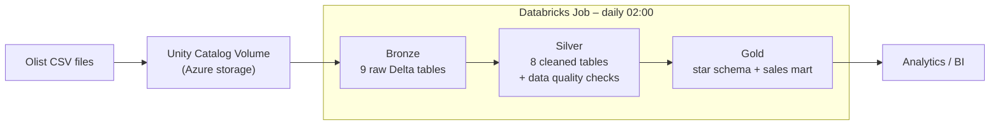
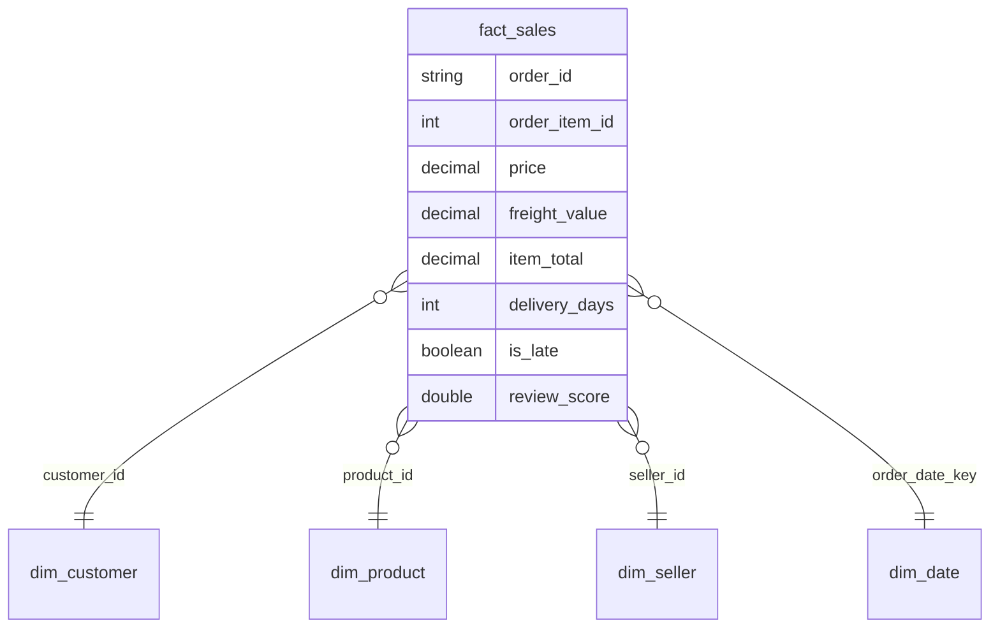

# Bazar9 – End-to-end data platform on Azure Databricks

Bazar9 is a fictional online marketplace. This project builds its data platform: from raw order data to a star schema that answers business questions, fully automated on Azure Databricks.

> Data source: the public [Brazilian E-Commerce Public Dataset by Olist](https://www.kaggle.com/datasets/olistbr/brazilian-ecommerce) (~100k orders, 2016–2018, license CC BY-NC-SA 4.0). Bazar9 is a fictional company used to frame the project.

## Business problem

Bazar9's order data lives in an operational webshop system: messy, spread across tables, and not built for analysis. Management wants answers to questions like:

- Which product categories generate the most revenue, per month?
- Do late deliveries lead to worse customer reviews?
- Where are our customers and sellers located?

## Architecture

| Layer | Purpose | Key techniques |
|---|---|---|
| **Bronze** | Raw copy of the source, untouched | All columns as string, lineage columns (`_ingested_at`, `_source_file`), idempotent overwrite |
| **Silver** | Single trusted version of the data | `try_cast` type conversion, deduplication on the correct grain (incl. composite keys), text normalisation, left join for translations, geolocation aggregated to prevent join explosion |
| **Gold** | Ready for business use | Kimball star schema, generated date dimension, derived metrics, pre-aggregated sales mart |

## Data model (gold)

- **Grain of `fact_sales`:** one row per product within an order (112,650 rows).
- Reviews are aggregated per order *before* joining, to avoid duplicating order lines.
- `sales_monthly_by_category`: pre-aggregated revenue, orders, average review and late-delivery percentage per month and category.

## Data quality

Referential integrity and validity checks in silver (all return 0):

- orders without a customer
- order items without an order or product
- payments without an order
- negative prices
- orders without a purchase date

## Key insight

| Delivery | Orders | Avg. review |
|---|---|---|
| On time | 89,936 | **4.21** |
| Late | 6,534 | **2.26** |

Late deliveries score almost 2 points lower on average. This is a strong correlation (not proof of causation), and points to delivery reliability as the biggest lever for customer satisfaction.

## Tech stack

Azure Databricks · PySpark · Spark SQL · Delta Lake · Unity Catalog · Azure Data Lake Storage Gen2 · Databricks Jobs · Git / GitHub

## Repository structure

| Notebook | Description |
|---|---|
| `01_bronze_olist` | Loads the 9 CSV files into bronze Delta tables with lineage |
| `02_silver_olist` | Cleans, types and deduplicates the data; runs quality checks |
| `03_gold_olist` | Builds the star schema, sales mart and business analysis |

## How to run

1. Upload the Olist CSV files to a Unity Catalog volume.
2. Clone this repo as a Databricks Git folder.
3. Run the notebooks in order (01 → 02 → 03), or create a Databricks Job with three dependent notebook tasks.

## Roadmap

- [ ] Ingestion with Azure Data Factory
- [ ] CI/CD with GitHub Actions and Databricks Asset Bundles (job definition as code)
- [ ] Incremental loading with Delta `MERGE` instead of full overwrite
- [ ] Late-delivery percentage calculated at order level instead of order-line level
- [ ] Dashboard on the gold layer
